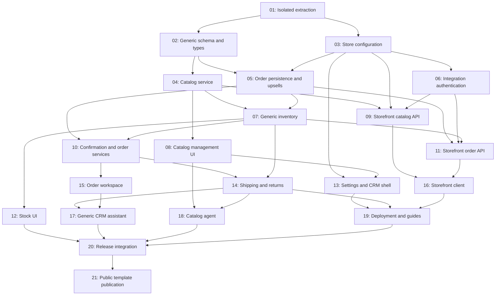

# Standalone COD CRM Starter

## Overview

Extract Zehri's operational CRM into the public GitHub template `aammo1/cod-crm-starter`. Each custom-built niche storefront connects to its own deployment of this CRM, which owns catalog, prices, inventory and COD operations. Preserve Zehri's workflow while replacing shoe-specific assumptions with generic variants.

## Quick Links

- [Requirements](./requirements.md)
- [Action Required](./action-required.md)

## Execution boundary

This folder is a specification in the Zehri repository. Implementation happens in a **new sibling workspace**, `/home/tal7a/Projects/cod-crm-starter`, initialized by task 01. All implementation file paths in tasks are relative to that workspace unless explicitly marked as source. Never point the new repository at Zehri's remote or database. All agents after task 01 must use the new workspace explicitly, including for checks and commits.

Task 01 is an intentionally larger bootstrap operation: it copies an explicit allowlist, not the source repository/history. Subsequent tasks have bounded ownership. Tasks 20 and 21 are serial integration/release gates. No standalone testing tasks are included; verification and necessary existing fixture updates belong to their implementation owners.

## Dependency Graph

## Waves

| Wave | Tasks | Description |
|---|---|---|
| 1 | 01 | Create the isolated, sanitized CRM project |
| 2 | 02, 03 | Generic schema/types and configurable store rules |
| 3 | 04, 05, 06 | Catalog, transactional commerce, and API authentication |
| 4 | 07, 08, 09 | Inventory, catalog management, and catalog read API |
| 5 | 10, 11, 12, 13 | Operational order services, checkout API, stock UI, settings |
| 6 | 14, 15, 16 | Fulfillment, order workspace, and integration client |
| 7 | 17, 18, 19 | Optional existing tools, deployment, and guides |
| 8 | 20 | Integrate the complete fresh-install release |
| 9 | 21 | Publish and enable the public GitHub template |

Waves are execution barriers; all tasks in a wave must finish before the next starts. Later-wave placement can intentionally serialize changes even where a direct data dependency is absent. Tasks within each wave have disjoint write sets, including script fixtures. A task may read other modules but may not silently edit another owner's files. Report newly discovered cross-cutting work to the orchestrator and schedule it serially.

Task 05 implements against the shared typed catalog port, with final runtime binding in task 11; it does not depend on task 04's same-wave implementation. Task 18 consumes the completed fulfillment behavior to verify that automation edits/archive/restore preserve variant IDs referenced by dispatched and returned orders. Full application checks may expose pending downstream migrations in intermediate waves; each owner must distinguish those from regressions in its own scope and record them for the release gate.

## Task Status

### Wave 1
- [x] [task-01-isolated-extraction](./tasks/task-01-isolated-extraction.md) — Standalone project bootstrap
### Wave 2
- [x] [task-02-generic-schema](./tasks/task-02-generic-schema.md) — Generic persistence and shared contracts
- [x] [task-03-store-configuration](./tasks/task-03-store-configuration.md) — Settings service and pricing
### Wave 3
- [x] [task-04-catalog-service](./tasks/task-04-catalog-service.md) — Flexible catalog CRUD
- [x] [task-05-order-persistence](./tasks/task-05-order-persistence.md) — Checkout persistence and durable upsells
- [x] [task-06-integration-auth](./tasks/task-06-integration-auth.md) — Authenticated server-to-server boundary
### Wave 4
- [x] [task-07-generic-inventory](./tasks/task-07-generic-inventory.md) — Variant-based stock
- [x] [task-08-catalog-management](./tasks/task-08-catalog-management.md) — Product management UI and routes
- [x] [task-09-catalog-api](./tasks/task-09-catalog-api.md) — Published catalog endpoints
### Wave 5
- [x] [task-10-order-operations](./tasks/task-10-order-operations.md) — Confirmation, manual orders, and edits
- [x] [task-11-order-api](./tasks/task-11-order-api.md) — Idempotent checkout and upsell endpoints
- [x] [task-12-stock-workspace](./tasks/task-12-stock-workspace.md) — Generic stock screens
- [x] [task-13-settings-shell](./tasks/task-13-settings-shell.md) — Store settings and neutral shell
### Wave 6
- [x] [task-14-fulfillment](./tasks/task-14-fulfillment.md) — Generic parcel descriptions and returns
- [x] [task-15-order-workspace](./tasks/task-15-order-workspace.md) — Generic order UI and handlers
- [x] [task-16-storefront-client](./tasks/task-16-storefront-client.md) — Typed client and Next.js examples
### Wave 7
- [x] [task-17-crm-assistant](./tasks/task-17-crm-assistant.md) — Preserve optional read-only assistant
- [x] [task-18-catalog-agent](./tasks/task-18-catalog-agent.md) — Preserve optional catalog automation
- [x] [task-19-deployment-guides](./tasks/task-19-deployment-guides.md) — Portable deployment and agent documentation
### Wave 8
- [x] [task-20-release-integration](./tasks/task-20-release-integration.md) — Close integration gaps and verify release
### Wave 9
- [x] [task-21-public-template](./tasks/task-21-public-template.md) — Publish `aammo1/cod-crm-starter`
