# Hardening and Growth

## Overview

Fix every confirmed defect from the October 2026 four-part audit (pricing, phone validation, idempotency, rate limits, migrations, env validation, health, backups), harden the template for live stores, and add the COD operator features that were missing (delivery outcomes, blocklist, UTM attribution, product cost, ad spend, COD remittance, city tariffs, auto-assignment, abandoned leads, KPI dashboard, CSV export, order tracking page, consent banner, Snap pixel). All `AGENTS.md` invariants stay in force.

## Quick Links

- [Requirements](./requirements.md) — full requirements and acceptance criteria
- [Action Required](./action-required.md) — manual steps needing human action

## Conventions

- Reserved migrations: `020_delivery_outcomes`, `021_customer_blocklist`, `022_variant_cost`, `023_ad_spend`, `024_order_attribution`, `025_cod_remittances`, `026_city_tariffs`, `027_checkout_leads`.
- Unit tests live in `scripts/unit/*.test.mjs` and run via `npm run test:unit` (added by task 11). Bug fixes include regression tests in their own task (no separate testing tasks).
- Tasks in one wave never touch the same file. Hot files (`orders.ts`, order detail page, CRM nav, `i18n.ts`, checkout route, `storefront-orders.ts`, `package.json`) pass between waves in a fixed order stated in each task.

## Dependency Graph

```mermaid
graph TD
  T01["01: Fix pack pricing for mixed variant prices"]
  T02["02: One shared Moroccan phone normalizer for browser and server"]
  T03["03: Harden the migration runner"]
  T04["04: Fail-fast environment validation and explicit courier provider"]
  T05["05: Enforce one worker owner per database"]
  T06["06: Body size limits on every JSON route and re-encoded admin uploads"]
  T07["07: Security headers (HSTS, CSP hardening)"]
  T08["08: Storefront localization, accessibility and layout polish"]
  T09["09: SEO metadata and structured data"]
  T10["10: Robust new-store wizard"]
  T11["11: Unit test runner, CI coverage and dependency updates"]
  T12["12: Agent-declared delivery outcomes (Livré / Refusé)"]
  T13["13: Order edits keep original prices and recompute pack discounts"]
  T14["14: Manual orders apply packs; deleted manual orders keep their idempotency record"]
  T15["15: Checkout funnel correctness (attempt keys, errors, totals)"]
  T16["16: Rate limits that one client cannot use to block everyone"]
  T17["17: Logout revokes the session; admins can sign out everywhere"]
  T18["18: Structured logs, per-worker error state and honest health"]
  T19["19: Automated, offsite, restore-verified backups"]
  T20["20: Close returns that arrive empty or are lost"]
  T21["21: Phone blocklist and richer customer history"]
  T22["22: Product cost price per variant"]
  T23["23: Daily ad spend entry"]
  T24["24: Accessible accent foreground color"]
  T25["25: Customer order tracking page"]
  T26["26: First-touch UTM and referrer attribution on orders"]
  T27["27: COD remittance reconciliation"]
  T28["28: Per-city courier cost and optional customer fee override"]
  T29["29: Automatic order assignment to agents"]
  T30["30: Abandoned checkout leads (opt-in)"]
  T31["31: Business KPIs on the CRM dashboard"]
  T32["32: Orders CSV export"]
  T33["33: Consent banner and Snap Pixel"]
  T34["34: Code consistency cleanup"]
  T35["35: Documentation, env examples and Compose sync"]
  T01 --> T13
  T01 --> T14
  T02 --> T15
  T08 --> T15
  T02 --> T16
  T06 --> T17
  T04 --> T18
  T05 --> T18
  T11 --> T19
  T06 --> T20
  T12 --> T21
  T06 --> T22
  T09 --> T24
  T10 --> T24
  T15 --> T24
  T12 --> T25
  T15 --> T25
  T15 --> T26
  T16 --> T26
  T21 --> T26
  T12 --> T27
  T23 --> T27
  T13 --> T28
  T21 --> T28
  T14 --> T29
  T21 --> T29
  T26 --> T29
  T24 --> T30
  T25 --> T30
  T26 --> T30
  T27 --> T30
  T12 --> T31
  T22 --> T31
  T23 --> T31
  T26 --> T31
  T27 --> T31
  T28 --> T31
  T12 --> T32
  T21 --> T32
  T26 --> T32
  T27 --> T32
  T24 --> T33
  T26 --> T33
  T30 --> T33
  T33 --> T34
  T34 --> T35
```

## Waves

| Wave | Tasks | Description |
|------|-------|-------------|
| 1 | task-01, task-02, task-03, task-04, task-05, task-06, task-07, task-08, task-09, task-10, task-11, task-12 | Independent fixes and foundations: pricing, phone, migrations, env, lease, body limits, headers, storefront polish, SEO, wizard, CI, delivery outcomes |
| 2 | task-13, task-14, task-15, task-16, task-17, task-18, task-19, task-20 | Fixes building on wave 1: order edits, manual orders, checkout funnel, rate limits, sessions, observability, backups, returns |
| 3 | task-21, task-22, task-23, task-24, task-25 | Blocklist/history, variant cost, ad spend, accent contrast, tracking page |
| 4 | task-26, task-27, task-28 | UTM attribution, COD remittance, city tariffs |
| 5 | task-29, task-30, task-31, task-32 | Auto-assignment, abandoned leads, KPI dashboard, CSV export |
| 6 | task-33 | Consent banner and Snap pixel |
| 7 | task-34 | Code cleanup |
| 8 | task-35 | Docs, env and Compose sync |

## Task Status

### Wave 1
- [x] [task-01-pack-pricing-fix](./tasks/task-01-pack-pricing-fix.md) — Fix pack pricing for mixed variant prices
- [x] [task-02-phone-normalization](./tasks/task-02-phone-normalization.md) — One shared Moroccan phone normalizer for browser and server
- [x] [task-03-migration-runner-hardening](./tasks/task-03-migration-runner-hardening.md) — Harden the migration runner
- [x] [task-04-env-boot-validation](./tasks/task-04-env-boot-validation.md) — Fail-fast environment validation and explicit courier provider
- [x] [task-05-single-process-lease](./tasks/task-05-single-process-lease.md) — Enforce one worker owner per database
- [x] [task-06-request-body-limits-and-upload-reencode](./tasks/task-06-request-body-limits-and-upload-reencode.md) — Body size limits on every JSON route and re-encoded admin uploads
- [x] [task-07-security-headers](./tasks/task-07-security-headers.md) — Security headers (HSTS, CSP hardening)
- [x] [task-08-storefront-polish](./tasks/task-08-storefront-polish.md) — Storefront localization, accessibility and layout polish
- [x] [task-09-seo-structured-data](./tasks/task-09-seo-structured-data.md) — SEO metadata and structured data
- [x] [task-10-new-store-wizard-robustness](./tasks/task-10-new-store-wizard-robustness.md) — Robust new-store wizard
- [x] [task-11-tooling-and-ci](./tasks/task-11-tooling-and-ci.md) — Unit test runner, CI coverage and dependency updates
- [x] [task-12-delivery-outcomes](./tasks/task-12-delivery-outcomes.md) — Agent-declared delivery outcomes (Livré / Refusé)

### Wave 2
- [x] [task-13-order-edit-repricing](./tasks/task-13-order-edit-repricing.md) — Order edits keep original prices and recompute pack discounts
- [x] [task-14-manual-orders-packs-tombstone](./tasks/task-14-manual-orders-packs-tombstone.md) — Manual orders apply packs; deleted manual orders keep their idempotency record
- [x] [task-15-checkout-funnel-correctness](./tasks/task-15-checkout-funnel-correctness.md) — Checkout funnel correctness (attempt keys, errors, totals)
- [x] [task-16-rate-limit-availability](./tasks/task-16-rate-limit-availability.md) — Rate limits that one client cannot use to block everyone
- [x] [task-17-session-revocation](./tasks/task-17-session-revocation.md) — Logout revokes the session; admins can sign out everywhere
- [x] [task-18-observability-and-health](./tasks/task-18-observability-and-health.md) — Structured logs, per-worker error state and honest health
- [x] [task-19-backups-offsite-restore](./tasks/task-19-backups-offsite-restore.md) — Automated, offsite, restore-verified backups
- [x] [task-20-return-close-without-units](./tasks/task-20-return-close-without-units.md) — Close returns that arrive empty or are lost

### Wave 3
- [x] [task-21-customer-blocklist-history](./tasks/task-21-customer-blocklist-history.md) — Phone blocklist and richer customer history
- [x] [task-22-variant-cost-price](./tasks/task-22-variant-cost-price.md) — Product cost price per variant
- [x] [task-23-ad-spend](./tasks/task-23-ad-spend.md) — Daily ad spend entry
- [x] [task-24-accent-foreground-theme](./tasks/task-24-accent-foreground-theme.md) — Accessible accent foreground color
- [x] [task-25-customer-order-tracking-page](./tasks/task-25-customer-order-tracking-page.md) — Customer order tracking page

### Wave 4
- [x] [task-26-utm-attribution](./tasks/task-26-utm-attribution.md) — First-touch UTM and referrer attribution on orders
- [x] [task-27-cod-remittance](./tasks/task-27-cod-remittance.md) — COD remittance reconciliation
- [x] [task-28-city-tariffs](./tasks/task-28-city-tariffs.md) — Per-city courier cost and optional customer fee override

### Wave 5
- [x] [task-29-auto-assignment](./tasks/task-29-auto-assignment.md) — Automatic order assignment to agents
- [x] [task-30-abandoned-checkout-leads](./tasks/task-30-abandoned-checkout-leads.md) — Abandoned checkout leads (opt-in)
- [x] [task-31-dashboard-kpis](./tasks/task-31-dashboard-kpis.md) — Business KPIs on the CRM dashboard
- [x] [task-32-orders-csv-export](./tasks/task-32-orders-csv-export.md) — Orders CSV export

### Wave 6
- [ ] [task-33-consent-and-snap-pixel](./tasks/task-33-consent-and-snap-pixel.md) — Consent banner and Snap Pixel

### Wave 7
- [x] [task-34-code-cleanup](./tasks/task-34-code-cleanup.md) — Code consistency cleanup

### Wave 8
- [x] [task-35-docs-and-env-sync](./tasks/task-35-docs-and-env-sync.md) — Documentation, env examples and Compose sync
