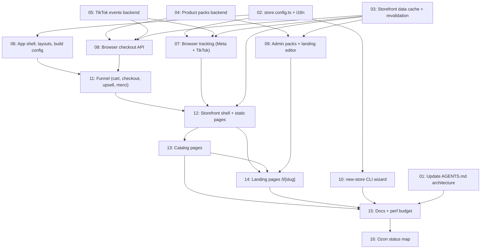

# Storefront Boilerplate

## Overview

This turns cod-crm-starter into a full per-niche boilerplate: one Next.js app per niche containing the existing tested CRM plus a new, fast, config-driven storefront. The storefront has catalog pages and per-product landing pages with quantity packs, zehri's funnel (cart → 2-field checkout → 20 s upsell → merci), Meta and TikTok browser and server tracking, and fr/ar (RTL) locales. Pages are served from an ISR cache that is invalidated on admin, stock and order changes, so the store has hellobaby's speed with zehri's features. `npm run new-store` sets up a new niche.

## Quick Links

- [Requirements](./requirements.md): full requirements and acceptance criteria
- [Action Required](./action-required.md): manual steps needing human action

## Dependency Graph

## Waves

| Wave | Tasks | Description |
|------|-------|-------------|
| 1 | task-01, task-02, task-03, task-04, task-05 | Foundations: architecture rules, config, cached data and revalidation, pack pricing, TikTok outbox |
| 2 | task-06, task-07, task-08, task-09, task-10 | App shell and build, browser tracking, in-app checkout API, admin pack editor, CLI wizard |
| 3 | task-11 | Funnel UI (lazy cart/checkout/upsell, merci) |
| 4 | task-12 | Storefront layout, header and footer, static pages |
| 5 | task-13 | Catalog pages (home, boutique, category, product, custom sections) |
| 6 | task-14 | Landing pages with packs and an inline order form |
| 7 | task-15, task-16 | Docs, Cloudflare, perf budget, Ozon status map (blocked on owner data) |

## Task Status

### Wave 1
- [x] [task-01-update-agents-architecture](./tasks/task-01-update-agents-architecture.md): Update AGENTS.md/README for the in-repo storefront
- [x] [task-02-store-config](./tasks/task-02-store-config.md): store.config.ts schema, loader and fr/ar UI strings
- [x] [task-03-storefront-data-cache](./tasks/task-03-storefront-data-cache.md): Cached storefront loaders, revalidation and boot warm-up
- [x] [task-04-product-packs-backend](./tasks/task-04-product-packs-backend.md): Quantity packs schema, service and checkout pricing
- [x] [task-05-tiktok-events-backend](./tasks/task-05-tiktok-events-backend.md): TikTok Events API outbox and worker

### Wave 2
- [x] [task-06-app-shell-and-build](./tasks/task-06-app-shell-and-build.md): Root/admin layout split, theme tokens, next.config, Dockerfile
- [x] [task-07-browser-tracking](./tasks/task-07-browser-tracking.md): Lazy Meta and TikTok pixels plus deduplicated relay
- [x] [task-08-storefront-checkout-api](./tasks/task-08-storefront-checkout-api.md): Same-origin checkout and upsell routes with attribution
- [x] [task-09-admin-packs-editor](./tasks/task-09-admin-packs-editor.md): Pack and landing editor in /admin
- [x] [task-10-new-store-cli](./tasks/task-10-new-store-cli.md): `npm run new-store` wizard

### Wave 3
- [x] [task-11-funnel](./tasks/task-11-funnel.md): Cart store, lazy drawer/checkout/upsell, merci

### Wave 4
- [x] [task-12-storefront-shell](./tasks/task-12-storefront-shell.md): Storefront layout, header, footer, static pages, sitemap

### Wave 5
- [x] [task-13-catalog-pages](./tasks/task-13-catalog-pages.md): Home, boutique, category, product pages, custom sections

### Wave 6
- [x] [task-14-landing-pages](./tasks/task-14-landing-pages.md): `/l/[slug]` with packs and an inline order form

### Wave 7
- [x] [task-15-docs-and-perf-budget](./tasks/task-15-docs-and-perf-budget.md): New-niche guide, Cloudflare docs, perf budget script
- [ ] [task-16-ozon-status-map](./tasks/task-16-ozon-status-map.md): Fill the Ozon STATUS_MAP from verified samples
